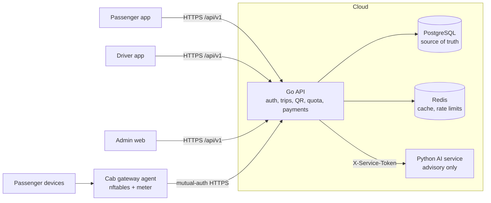

# Architecture overview

SARATHI is a **modular monolith** (Go) plus an **advisory** Python service. Splitting further requires a measured operational reason.

## Authority boundaries (design rules)

| Decision | Authority | Never |
|---|---|---|
| Identity, payments, quota grants | Go API (PostgreSQL ledger) | AI service, mobile app |
| Traffic measurement & blocking | Gateway | Mobile app |
| Analytics, anomaly hints | AI service (advisory) | May not authorize, grant, or disable controls |

## Implemented in Milestone 1
`backend/internal/{config,middleware,httpapi,database,cache}`, `backend/migrations`, `backend/cmd/api`, `ai/app`.

## Conventions
* Success: `{"data": ...}`. Error: `{"error": {"code", "message", "request_id"}}`.
* `/healthz` = liveness (no dependency checks). `/readyz` = readiness (PostgreSQL, Redis); failure detail is logged, not returned.
* Logs never include headers, query strings or bodies.
