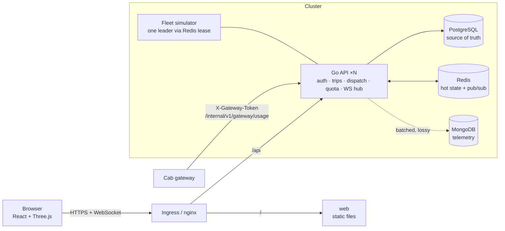

# Architecture overview

SARATHI is a **modular monolith** (Go) with a React/Three.js web client, three
datastores with distinct jobs, and an advisory Python service that is not on any
request path.

## Backend packages (`backend/internal`)

| Package | Responsibility |
|---|---|
| `config` | Environment parsing; refuses unsafe production settings (log OTP sender, mock payments, weak secrets, wildcard CORS) |
| `store` | PostgreSQL queries and transactions |
| `live` | Redis: OTP, rate limits, WS tickets, cab positions/geo, pub/sub, leader lease |
| `telemetry` | MongoDB: buffered position and trip-event writes, timeline reads |
| `auth` | JWT access tokens, boarding codes, OTP senders |
| `geo` | Service-area grid, routing, pricing |
| `core` | Business rules; the single path for every state change |
| `realtime` | WebSocket hub fed by Redis pub/sub |
| `simulator` | Demo fleet driving through `core` |
| `httpapi`, `middleware` | Routing, handlers, metrics, request IDs, limits, CORS |

## Key flows

**Sign-in.** `otp/request` stores an HMAC of a random 6-digit code in Redis (5-minute
TTL) and sends it. `otp/verify` runs one Lua script that counts the attempt and
compares, so parallel guesses cannot exceed five. Success returns a 15-minute HS256
access token and a 30-day refresh token (only its SHA-256 is stored). Refresh rotates
the token; presenting a rotated token revokes every session of that user.

**Booking.** Redis `GEOSEARCH` returns the nearest available cabs. One PostgreSQL
transaction locks the first still-available candidate (`FOR UPDATE SKIP LOCKED`),
marks it `on_trip` and inserts the trip. Partial unique indexes guarantee one live
trip per passenger and per cab even under races. `Idempotency-Key` makes retries safe.

**Trip lifecycle.** `assigned → in_progress → completed`, or `assigned → cancelled`.
Each transition is a conditional `UPDATE ... WHERE status = <from>`; a stale caller
gets 409. Starting requires the passenger's boarding code, an HMAC of the trip id that
is never stored. After commit, `core` updates Redis, queues a MongoDB event and
publishes to the passenger's (and driver's) private topic.

**Quota.** `quota_ledger` is append-only (a trigger rejects UPDATE/DELETE). Usage
reports lock the user row, clamp the debit to the remaining balance and are idempotent
by `report_id`, so the balance cannot go negative or be charged twice.

**Realtime.** Clients fetch a single-use ticket over HTTPS, then open the WebSocket
with it (tokens never appear in URLs). Every replica subscribes to
`sarathi:rt:*` and forwards the public `fleet` topic plus the caller's own `user:<id>`
topic. Slow clients are disconnected and resync on reconnect.

## Authority boundaries

| Decision | Authority | Never |
|---|---|---|
| Identity, fares, trip state, quota grants | Go API + PostgreSQL | Clients, AI service |
| Usage measurement | Gateway (simulator today) | Passenger app |
| Live positions, rate limits | Redis (rebuildable) | — |
| History and analytics | MongoDB, AI service (advisory) | May not authorize anything |

## Conventions

* `/healthz` = liveness. `/readyz` = PostgreSQL and Redis must answer; MongoDB is
  reported but does not fail readiness.
* Logs are JSON, one line per request, and never include headers, query strings or
  bodies. Phone numbers are masked.
* Request bodies are limited to 1 MiB, must be a single JSON object and may not
  contain unknown fields.
