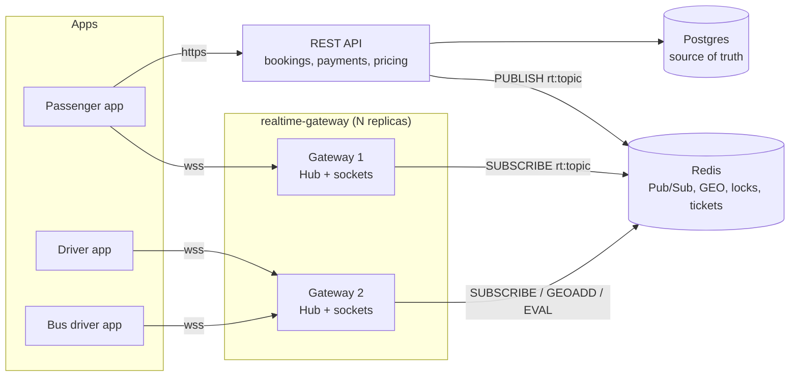

# Sarathi Realtime: WebSockets on top of Redis, step by step

This guide adds live, two-way communication to Sarathi: driver GPS on the passenger's map, ride offers to drivers, fuel and EV station crowd levels, bus tracking, food-order and QR-pass notifications. It assumes Redis is already running (`infra/redis/redis.conf`), as in your repo.

Every step names the file it creates. The files are in this bundle at the same paths as in your repo (`backend/...`, `apps/...`, `infra/...`), so you can copy them straight in.

---

## Contents

0. [What realtime does for each Sarathi feature](#step-0--what-realtime-does-for-each-sarathi-feature)
1. [Architecture](#step-1--architecture)
2. [Install dependencies and fix the module path](#step-2--install-dependencies-and-fix-the-module-path)
3. [Design the message protocol](#step-3--design-the-message-protocol-envelopego)
4. [Design topics and Redis keys](#step-4--design-topics-and-redis-keys)
5. [Authenticate sockets with one-time tickets](#step-5--authenticate-sockets-with-one-time-tickets-ticketgo)
6. [The Client: read pump, write pump, heartbeats, back-pressure](#step-6--the-client-read-pump-write-pump-heartbeats-back-pressure-clientgo)
7. [The Hub: local fan-out + Redis Pub/Sub](#step-7--the-hub-local-fan-out--redis-pubsub-hubgo)
8. [Presence: who is online](#step-8--presence-who-is-online-presencego)
9. [Router and authorization](#step-9--router-and-authorization-routergo-authzgo)
10. [The upgrade endpoint](#step-10--the-upgrade-endpoint-servergo)
11. [Publisher: pushing from REST and workers](#step-11--publisher-pushing-from-rest-and-workers-publishergo)
12. [Feature: live driver location (Redis GEO)](#step-12--feature-live-driver-location-redis-geo)
13. [Feature: ride dispatch with atomic accept](#step-13--feature-ride-dispatch-with-atomic-accept)
14. [Feature: fuel / EV station crowd and GPS rating](#step-14--feature-fuel--ev-station-crowd-and-gps-rating)
15. [Feature: everything else, pushed from REST](#step-15--feature-everything-else-pushed-from-rest)
16. [The gateway binary and graceful shutdown](#step-16--the-gateway-binary-and-graceful-shutdown)
17. [Infra: Docker, Compose, Redis config, Nginx](#step-17--infra-docker-compose-redis-config-nginx)
18. [The app-side client (React / React Native)](#step-18--the-app-side-client-react--react-native)
19. [Test it by hand](#step-19--test-it-by-hand)
20. [Production checklist](#step-20--production-checklist)

---

## Step 0: What realtime does for each Sarathi feature

Most of Sarathi stays REST: search a route, compute fares, create a booking, pay. WebSockets are only for things that **change while the user is looking at the screen**.

| Feature from your spec | Realtime need | Direction | Topic |
|---|---|---|---|
| Map: car follows route, live position | Your own car's GPS feeds station rating | app → server | (none) |
| Map: nearby petrol / EV stations | Crowd level changes live | server → app | `station:{id}` |
| Best petrol pump by GPS-counted cars | Every car's GPS is counted at stations | app → server | (none) |
| Cab booking (solo / shared / pickup-and-return) | Offer to nearby drivers, first accept wins | both | `user:{driverId}` |
| Trip screen | Driver position, status (arriving, started …) | server → app | `trip:{id}` |
| Shared cab | Co-passengers see the same car + "co-passenger added" | server → app | `trip:{id}` |
| Premium / vintage (hourly), tourist (daily), self-drive, test-drive | Booking confirmed, car dispatched, deposit refunded | server → app | `user:{id}` |
| Daily commuter QR pass | "Pass scanned at Metro gate 3, ₹22 debited" | server → app | `user:{id}` |
| Premium commuter bus | Live bus position, seat assigned, "bus 3 min away" | server → app | `bus:{id}` |
| Luxury long-distance bus food orders | Order accepted, picked up at halt, delivered to seat | server → app | `user:{id}` / `bus:{id}` |

Car dimensions and road-width checks for the Map belong in the routing service (REST). They don't need sockets.

---

## Step 1: Architecture



Four rules shape everything that follows:

1. **The gateway is a separate binary** (`cmd/realtime-gateway`). Sockets stay open for hours and use memory. REST requests last milliseconds and use CPU. Running them as separate services lets you scale each one on its own.
2. **Redis Pub/Sub is the bus between processes.** A passenger on Gateway 1 and their driver on Gateway 2 still talk, because both gateways subscribe to `rt:trip:{id}` in Redis. You don't need sticky sessions.
3. **State lives in Postgres or Redis keys. Pub/Sub only carries notifications.** Pub/Sub is fire-and-forget. A phone that was in a tunnel misses messages, so on every reconnect the app re-reads state over REST.
4. **Each `*websocket.Conn` has exactly one reader goroutine and one writer goroutine.** gorilla/websocket requires this. Everything else sends through a channel.

Folder layout added to your repo:

```
backend/
  cmd/realtime-gateway/main.go           # Step 16
  internal/realtime/                     # transport only, no business logic
    envelope.go   ticket.go   client.go   hub.go   presence.go
    router.go     authz.go    server.go   publisher.go
    handlers/handlers.go                 # glue: WS messages -> features
  internal/geo/drivers.go                # Step 12
  internal/geo/stations.go               # Step 14
  internal/dispatch/dispatch.go          # Step 13
apps/shared/realtime/
  sarathiSocket.ts  useTripLive.ts       # Step 18
infra/realtime/
  compose.realtime.yaml  Dockerfile.gateway  redis.realtime.conf  nginx.realtime.conf
```

---

## Step 2: Install dependencies and fix the module path

```bash
cd backend
go get github.com/gorilla/websocket@v1.5.3
go get github.com/redis/go-redis/v9@latest
go mod tidy
```

If your Redis layer already uses `go-redis/v9`, reuse that client. Every constructor here takes `redis.UniversalClient`, so a plain client, Sentinel or Cluster all work.

**Fix the import path.** The files import `sarathi/backend/internal/...`. Replace that with the `module` line of your `backend/go.mod`:

```bash
MOD=$(head -1 go.mod | awk '{print $2}')       # e.g. github.com/you/sarathi/backend
grep -rl '"sarathi/backend/' --include=*.go . | xargs sed -i "s#\"sarathi/backend/#\"$MOD/#g"
go build ./...
```

You need Redis 6.2 or newer for `GETDEL` and `GEOSEARCH`. Check with `redis-cli INFO server | grep redis_version`.

---

## Step 3: Design the message protocol (`envelope.go`)

Settle the wire format first. Every frame in both directions is one JSON shape:

```json
{ "type": "driver.location", "ref": "c7", "topic": "trip:7f3a", "data": { ... }, "ts": 1764084000000 }
```

| Field | Who sets it | Why |
|---|---|---|
| `type` | both | Routes the message (`subscribe`, `location.update`, `trip.status` …) |
| `ref` | client | Optional request id. The server answers `{"type":"ack","ref":"c7"}` or `{"type":"error","ref":"c7","data":{"code":"forbidden",...}}`, which lets the client `await` a request. |
| `topic` | both | Which stream the message belongs to |
| `data` | both | Payload, kept as `json.RawMessage` so each handler decodes only its own shape |
| `ts` | server | Server time in ms, so the app can drop stale GPS frames |

Messages from client to server: `subscribe`, `unsubscribe`, `ping`, `location.update`, `driver.availability`, `offer.accept`, `offer.decline`.

Messages from server to client: `welcome`, `ack`, `error`, `pong`, `trip.offer`, `trip.offer.cancelled`, `trip.status`, `driver.location`, `bus.location`, `station.crowd`, `food.order`, `pass.scanned`, `booking.update`.

`envelope.go` also defines:

- **`Identity`**: `userId`, `role` (`passenger | driver | bus_driver | admin`), `vehicleId` and `vehicleClass`. It's created by your REST auth and attached to the socket. Clients can never set it themselves.
- **`ClientError`**: errors that are safe to show the user. Any other error becomes a generic `internal` error, so internal details don't leak.
- **`ParseTopic`**: a strict validator (`kind:id`, id matching `[A-Za-z0-9_-]{1,64}`). It stops anyone from subscribing to `trip:*` or other odd strings.

> **Why one envelope?** One decoder, one logger and one TypeScript type. New features become new `type` values without changing the protocol.

---

## Step 4: Design topics and Redis keys

A **topic** is what a socket subscribes to. A **Redis channel** is `rt:` + topic.

| Topic | Who may subscribe | Written by |
|---|---|---|
| `user:{userId}` | That user only. Subscribed automatically on connect. | Anything with a private notification |
| `trip:{tripId}` | Members of `trip:{id}:members` (passenger(s) + assigned driver) | dispatch, driver GPS |
| `bus:{busId}` | Members of `bus:{id}:members` (ticket holders + bus driver) | bus driver GPS, bus booking service |
| `station:{stationId}` | Everyone | station tracker |

Redis keys used by the realtime layer:

| Key | Type | TTL | Purpose |
|---|---|---|---|
| `wsticket:{ticket}` | string | 30 s | One-time socket login |
| `online:{userId}` | zset | 90 s | Presence: connection ids, scored by expiry time |
| `geo:drivers:{class}` | GEO | (pruned) | Driver positions per class (`hatch5`, `sedan5`, `suv7`, `premium`, `vintage`, `testdrive`) |
| `geo:drivers:{class}:seen` | zset | (pruned) | Last GPS time, so stale drivers get removed |
| `driver:{id}:status` | string | 120 s, refreshed by GPS | `idle` or `busy` |
| `trip:{id}` | hash | 24 h | `status`, `passenger_id`, `driver_id`, `mode`, `class` |
| `trip:{id}:offered` | set | 20 s | Drivers currently offered the trip |
| `trip:{id}:members` | set | 24 h | Who may subscribe to `trip:{id}` |
| `bus:{id}:members` | set | run + 2 h | Who may subscribe to `bus:{id}` |
| `geo:stations` | GEO | (none) | All fuel / EV / CNG stations |
| `station:{id}:present` | zset | 1 h | Cars at the station in the last 10 min |
| `station:{id}:cars:{yyyymmdd}` | HyperLogLog | 8 d | Unique cars that really stopped there |

---

## Step 5: Authenticate sockets with one-time tickets (`ticket.go`)

**The problem:** a browser's `new WebSocket(url)` can't send an `Authorization` header. Putting the JWT in the URL leaks it into proxy and access logs.

**The solution:** a one-time ticket.

```
App ──POST /v1/realtime/ticket (Bearer JWT)──▶ REST API ──SET wsticket:abc {identity} EX 30──▶ Redis
App ──GET wss://rt.../ws?ticket=abc──▶ Gateway ──GETDEL wsticket:abc──▶ Redis  (works exactly once)
```

What to do:

1. Mount the ticket endpoint in your **existing REST API**, behind your existing JWT middleware:

   ```go
   tickets := realtime.NewTicketStore(rdb, 30*time.Second)
   mux.Handle("POST /v1/realtime/ticket", authMiddleware(realtime.TicketHandler(tickets,
       func(r *http.Request) (realtime.Identity, bool) {
           u, ok := auth.UserFromContext(r.Context()) // your function
           if !ok { return realtime.Identity{}, false }
           return realtime.Identity{
               UserID: u.ID, Role: realtime.Role(u.Role),
               VehicleID: u.VehicleID, VehicleClass: u.VehicleClass,
           }, true
       })))
   ```

2. The gateway calls `tickets.Redeem()` **before** upgrading the connection (Step 10). A bad ticket gets a normal `401`, which is easier for the app to handle than a socket that opens and then closes.

Properties worth knowing:

- 32 random bytes, so tickets can't be guessed.
- `GETDEL` is atomic, so a ticket replayed from a log or a proxy fails.
- Any gateway replica can redeem any ticket, because the ticket lives in Redis.
- The identity (role, vehicle) is fixed when the ticket is issued. If a driver changes vehicle, the app reconnects with a fresh ticket.

---

## Step 6: The Client: read pump, write pump, heartbeats, back-pressure (`client.go`)

Each connection is a `Client` with two goroutines.

```
              ┌──────────── readPump ────────────┐
socket ──────▶│ ReadMessage → JSON → router.Handle│──▶ handlers (Redis, dispatch...)
              └───────────────────────────────────┘
              ┌──────────── writePump ───────────┐
hub / handlers│ c.send (chan, 256) ──▶ WriteMessage│──▶ socket
   ──Enqueue─▶│ ticker 54s ──▶ PingMessage        │
              │ c.done ──▶ CloseMessage + Close   │
              └───────────────────────────────────┘
```

Line-by-line reasoning:

1. **Constants.** `pongWait = 60s` and `pingPeriod = 54s`. The server sends a protocol ping every 54 s. Phones and browsers answer with a pong automatically. Every pong or frame pushes the read deadline forward 60 s. If the phone drops off the network silently (lift, tunnel, airplane mode), `ReadMessage` fails after 60 s and the socket is cleaned up. Without this, a driver who lost signal would stay "online" and keep receiving trip offers.
2. **`SetReadLimit(8 KB)`.** A malicious client can't send a 1 GB frame.
3. **`Enqueue` never blocks.** It uses `select { case c.send <- frame: default: close as slow }`. If a client's 256-frame buffer is full, the client is too slow (bad 2G connection or a frozen app). It gets disconnected with code `1013 Try Again Later` and the app reconnects. One slow phone never slows down fan-out to thousands of others.
4. **`done` channel + `sync.Once`.** `Close()` can be called from any goroutine any number of times. Only `writePump` writes the close frame, which keeps the one-writer rule.
5. **The `send` channel is never closed.** Closing it while another goroutine sends would panic. Shutdown is signalled through `done` instead.
6. **`readPump`'s `defer` unregisters from the hub.** Every way a socket can die (error, timeout, close frame, server shutdown) ends up in `hub.unregister`.
7. **`AllowLocation`** is a simple per-socket rate limit for GPS (one frame per 0.9 s). It runs only on the reader goroutine, so it needs no lock.

---

## Step 7: The Hub: local fan-out + Redis Pub/Sub (`hub.go`)

The Hub is the core of the system. It keeps two maps:

```go
clients map[*Client]struct{}                 // every local socket
topics  map[string]map[*Client]struct{}      // topic -> local subscribers
```

**Subscribe flow:**

1. `hub.subscribe(c, "trip:7f3a")` adds the client to the local map.
2. If this is the **first** local subscriber for that topic, the topic is marked *pending*.
3. `reconcileLoop` (a single goroutine) compares "local subscribers > 0?" with "already subscribed in Redis?". It then calls `ps.Subscribe(ctx, "rt:trip:7f3a")` or `ps.Unsubscribe(...)`.

**Why a reconcile loop instead of subscribing directly?** Suppose passenger A subscribes to `trip:7f3a` while passenger B, the last subscriber, leaves at the same moment. If both goroutines called Redis directly, the UNSUBSCRIBE could land after the SUBSCRIBE and A would hear nothing. A single goroutine that re-reads the *current* local state before calling Redis can't get this wrong. Failures retry after one second.

**Receive flow (`Run`):**

```go
h.ps = h.rdb.Subscribe(ctx, "rt:_gw:"+gatewayID)   // opens the dedicated Pub/Sub connection
h.ps.Receive(ctx)                                  // wait until Redis confirms
for msg := range h.ps.Channel(redis.WithChannelSize(4096)) {
    topic := strings.TrimPrefix(msg.Channel, "rt:")
    h.deliverLocal(topic, []byte(msg.Payload))     // bytes forwarded as-is, no re-encoding
}
```

- `deliverLocal` copies the subscriber list under a **read** lock, then sends **outside** the lock.
- Messages are published as finished JSON frames (Step 11), so the gateway never decodes them. Fan-out costs one memory copy per socket.
- go-redis reconnects **and re-subscribes** automatically if Redis restarts.
- Every socket is automatically subscribed to `user:{its own id}` when it registers, and can't unsubscribe from it.

`CloseAll(1012, "server restarting")` is used at shutdown (Step 16).

---

## Step 8: Presence: who is online (`presence.go`)

You'll need to answer "is this driver connected right now?" (before offering trips) and "should I send a socket message or an FCM push?".

- One sorted set per user: `online:{userId}`. Each member is a connection id, scored by its expiry timestamp.
- `register` adds the connection. Every ping (54 s) refreshes the score. `unregister` removes it.
- If a gateway crashes, its entries age out after 90 s, so nobody stays online forever.
- From any service: `realtime.IsOnline(ctx, rdb, userID)` runs `ZCOUNT online:{id} now +inf`.

A user can have several connections (phone + tablet), and each one is tracked separately.

---

## Step 9: Router and authorization (`router.go`, `authz.go`)

The **Router** maps `type` to a handler:

```go
router.On("offer.accept", func(ctx context.Context, c *realtime.Client, env realtime.Envelope) error {
    ...
    return nil                                  // -> {"type":"ack","ref":...}
    return realtime.ErrForbidden                // -> {"type":"error","data":{"code":"forbidden"}}
    return fmt.Errorf("db down")                // -> logged; client sees {"code":"internal"}
})
```

- `ping`, `subscribe` and `unsubscribe` are built in.
- Each message gets a 5-second context timeout, so a hung Redis call can't freeze a socket's read loop forever.
- Handlers run on the socket's read goroutine. Messages from one client are processed **in order**, and a slow handler slows down only that client.

The **Authorizer** is checked on every subscribe:

| Topic | Rule |
|---|---|
| `user:X` | `X == my userId` |
| `trip:X` | `SISMEMBER trip:X:members myUserId` |
| `bus:X` | `SISMEMBER bus:X:members myUserId` |
| `station:X` | allowed |
| anything | allowed for `admin` (ops dashboard) |

**Your booking services must fill the membership sets.** Dispatch already does this for trips (Step 13). For buses, add the passenger when a seat is booked:

```go
rdb.SAdd(ctx, realtime.BusMembersKey(busRunID), passengerID)
rdb.ExpireAt(ctx, realtime.BusMembersKey(busRunID), arrivalTime.Add(2*time.Hour))
```

---

## Step 10: The upgrade endpoint (`server.go`)

`GET /ws?ticket=...` runs these steps in order:

1. **Redeem the ticket** (`401` if invalid, `503` if Redis is down).
2. **Check Origin.** Only your web origins are allowed, plus requests with *no* Origin header, which is how native React Native apps connect. This blocks cross-site WebSocket hijacking from other websites.
3. **Upgrade** with `upgrader.Upgrade`. On failure the upgrader has already replied to the client.
4. **Create the client, register it, start both pumps** with `go c.writePump()` and `go c.readPump(baseCtx)`.
5. **Send `welcome`** with `connId`, `userId`, `role` and `gateway`, which is useful for debugging.

Note: the pumps get the **process** context (`baseCtx`), not `r.Context()`. The request context is cancelled when `ServeHTTP` returns, which happens immediately.

Compression is off on purpose. GPS frames are about 120 bytes, and per-message deflate costs about 300 KB of memory per socket plus CPU.

---

## Step 11: Publisher: pushing from REST and workers (`publisher.go`)

Any process (REST API, cron job, payment webhook) can push to sockets with **only a Redis client**:

```go
pub := realtime.NewPublisher(rdb)
pub.Publish(ctx, realtime.UserTopic(uid), realtime.TypeBookingUpdate, booking)
```

`PublishPipe` adds the publish to a pipeline, so a state change and its notification reach Redis in one round trip.

**The golden rule:** write the state first, then publish.

```go
tx.UpdateBookingStatus(ctx, id, "confirmed")       // 1. Postgres (truth)
pub.Publish(ctx, realtime.UserTopic(uid), "booking.update", ...)  // 2. notify
```

The app re-reads state over REST on every reconnect (`onResync`, Step 18), so a missed notification never means lost information.

---

## Step 12: Feature: live driver location (Redis GEO)

**File:** `internal/geo/drivers.go`, used by `handlers.go` → `locationUpdate`.

The driver app sends about one frame per second:

```json
{"type":"location.update","data":{"lat":28.6139,"lng":77.2090,"heading":92,"speedKmh":31,"accuracyM":6,"tripId":"7f3a"}}
```

The handler then:

1. Validates coordinates, rejects `0,0`, applies the rate limit (0.9 s), and ignores fixes worse than 100 m accuracy.
2. **If role = driver:** `DriverIndex.Update` runs one pipeline:
   ```
   GEOADD geo:drivers:sedan5 77.2090 28.6139 driver42
   ZADD   geo:drivers:sedan5:seen <now> driver42
   EXPIRE driver:driver42:status 120          # GPS keeps availability alive
   ```
3. **If `tripId` is set and this driver is the assigned driver** (`HGET trip:{id} driver_id`), it publishes `driver.location` to `trip:{id}`. The check stops a driver from spoofing positions onto someone else's trip.
4. **If role = bus_driver**, it publishes `bus.location` to `bus:{vehicleId}`. Commuters and luxury-bus passengers watch this.
5. **Every car** (except buses) feeds the station tracker (Step 14).

**Finding drivers near a pickup point:**

```go
drivers.Nearby(ctx, "sedan5", lat, lng, 3 /*km*/, 15)
// GEOSEARCH geo:drivers:sedan5 FROMLONLAT lng lat BYRADIUS 3 km ASC COUNT 15 WITHDIST WITHCOORD
```

**Stale drivers:** GEO members never expire on their own. `RunJanitor` runs every 15 s on each gateway and removes drivers with no GPS for 60 s. `ZREM` is idempotent, so several gateways running it at once is harmless.

**Online / offline toggle** (`driver.availability`):
- Online: `SET driver:{id}:status idle NX`. `NX` means a `busy` status is never overwritten.
- Offline: a Lua script deletes the status **only if it's `idle`**, so a driver can't drop a passenger mid-trip with the toggle.

**For the "show cars on the passenger map" screen**, call `Nearby` from a REST endpoint every 5 to 10 s. A WebSocket stream of every car in the city isn't worth the traffic.

---

## Step 13: Feature: ride dispatch with atomic accept

**File:** `internal/dispatch/dispatch.go`

This covers all three cab modes from your spec:

| Mode | `Mode` value | Class rule | Extra |
|---|---|---|---|
| Normal cab, no parking fee | `solo` | any | (none) |
| Shared cab, cheaper | `shared` | any | `AddSharedPassenger` adds co-riders to the same trip |
| Pick up someone and return | `pickup_return` | `hatch5`/`sedan5` (5-seat) or `suv7` (7-seat) only, no model choice | `ParkingPaise` shown to the driver and charged to the passenger |

**13.1 Offer.** Your REST handler for `POST /v1/trips`, after inserting the trip into Postgres and computing the fare, calls:

```go
n, err := dispatchSvc.Offer(ctx, dispatch.RideRequest{
    TripID: trip.ID, PassengerID: user.ID, Mode: dispatch.ModeShared,
    VehicleClass: "sedan5", PickupLat: ..., FarePaise: 18500,
})
if errors.Is(err, dispatch.ErrNoDrivers) { /* tell the app: try again / widen search */ }
```

`Offer` then:
1. Finds the 15 closest drivers (`GEOSEARCH`) and keeps the first 5 whose `driver:{id}:status` is `idle`.
2. In **one MULTI/EXEC transaction**: writes `trip:{id}` (status `searching`), `trip:{id}:offered` (TTL 20 s, which is the offer window), adds the passenger to `trip:{id}:members`, publishes `trip.offer` to each driver's `user:{id}`, and publishes `trip.status: searching` to the trip.

**13.2 Accept.** The driver taps Accept and sends `{"type":"offer.accept","ref":"a1","data":{"tripId":"7f3a"}}`.

Two drivers can tap within the same millisecond on two different gateways, so the check-and-assign must be atomic. A Lua script does it, because Redis runs a script without interleaving any other command:

```lua
if HGET trip status ~= 'searching'   then return 0  end   -- someone else won
if not SISMEMBER trip:offered driver then return -1 end   -- offer expired (20 s TTL) or never offered
if GET driver:status ~= 'idle'       then return -2 end   -- went offline / already busy
HSET trip status driver_assigned driver_id <driver>
SET  driver:status busy EX 7200
SADD trip:members <driver>                                  -- driver may now subscribe to trip:{id}
return 1
```

These cases were tested against Redis 7: the first driver gets `1`, the second gets `0`, a non-offered driver gets `-1` and an offline driver gets `-2`.

After a win, `Accept`:
1. Persists to Postgres through your `TripRepository.MarkDriverAssigned`. **If that fails, it rolls back the Redis lock** so the trip can be offered again.
2. Publishes `trip.status: driver_assigned` to `trip:{id}` **and** the passenger's `user:{id}`, in case the passenger hasn't subscribed to the trip yet.
3. Sends `trip.offer.cancelled` to the other drivers so their offer cards disappear.

The driver sees `ack` (they won) or `error` with code `trip_taken`, `offer_expired` or `not_idle`.

**13.3 The rest of the trip.** Call `dispatchSvc.UpdateStatus(ctx, tripID, "arriving" | "started" | "completed" | "cancelled")` from your REST endpoints. `completed` and `cancelled` set the driver back to `idle`.

**13.4 Re-dispatch (next step for you).** If nobody accepts within 20 s, run `Offer` again with `RadiusKm` 5, then 8. A simple way is a worker that scans trips still in `searching` older than 20 s, or `time.AfterFunc` in the API process.

**Plug in Postgres:** implement

```go
type TripRepository interface {
    MarkDriverAssigned(ctx context.Context, tripID, driverID string) error
}
```

Then pass it to `dispatch.NewService` (it's `nil` in `main.go` for now). Use `UPDATE trips SET driver_id=$2, status='driver_assigned' WHERE id=$1 AND status='searching'` so the database enforces the same rule.

---

## Step 14: Feature: fuel / EV station crowd and GPS rating

**File:** `internal/geo/stations.go`

Your spec says to rate petrol pumps by the number of cars GPS sees there. A naive "count cars within 60 m" also counts every car **driving past** on the road outside, so a pump on a busy highway would always look like the best one. `Observe` counts a car as a visit only when **all three** of these hold:

1. It's inside the 60 m geofence (`GEOSEARCH geo:stations ... BYRADIUS 60 m COUNT 1`).
2. It's moving slower than 8 km/h.
3. It's **still** inside 90 s after first being seen there (`SET stdwell:{sid}:{car} <firstSeen> NX EX 900`).

When a visit is confirmed:

| Redis command | Meaning |
|---|---|
| `ZADD station:{sid}:present <now> car` + trim older than 10 min | **Cars there now**, for the live crowd level |
| `SET stvisit:{sid}:{car} 1 NX EX 7200` | Count the same car once per 2 h |
| `PFADD station:{sid}:cars:{yyyymmdd} car` | **Unique cars per day** (HyperLogLog, at most 12 KB, about 0.8 % error) |
| `SET station:{sid}:crowdpub 1 NX EX 15` → `PUBLISH station.crowd` | At most one live update per 15 s per station |

**Rating:**

```go
v, _ := stations.WeeklyVisitors(ctx, sid)   // PFCOUNT over 7 day-keys = UNION (regulars counted once)
stars := geo.Stars(map[string]int64{"st1": 420, "st2": 95, "st3": 12})
// -> st1 5.0, st2 ~4.0, st3 ~2.7   (log scale, relative to the stations on THIS route)
```

Stations are rated **relative to their neighbours on the route**. A village pump with 40 cars a week can still be the best option on a rural highway.

**Showing stations along the journey** (REST endpoint, not WebSocket):

1. Take the route polyline from your routing service and sample a point every ~5 km.
2. Call `stations.NearRoute(ctx, lat, lng, 2, 10)` for each point and deduplicate.
3. Filter by `station:{id}:meta` `type`: `petrol`/`diesel`/`cng` for fuel cars, `ev` for EVs.
4. **Reachability from fuel or battery level:** `rangeKm = fuelLitres × kmPerLitre × 0.85` (or `batteryKWh × kmPerKWh × 0.85`), using the per-model efficiency from your car catalogue. Mark stations beyond `rangeKm` (by distance along the route) as unreachable, and highlight the last reachable one.
5. Add `WeeklyVisitors` → `Stars`, plus the current `carsNow` level.
6. The app then `subscribe`s to `station:{id}` for the next 3 to 5 stations to get live crowd updates while driving.

Load stations at startup with `stations.Load(ctx, listFromPostgres)`.

**Privacy:** collecting location from private cars needs explicit consent in Map mode. Only the vehicle id is stored, inside sets that expire within 8 days.

---

## Step 15: Feature: everything else, pushed from REST

These features are request/response plus a notification, so each needs only one `Publish` line in your existing services:

```go
// Daily commuter QR pass: scanner backend validates a scan at a metro gate / bus / cab
pub.Publish(ctx, realtime.UserTopic(pass.UserID), realtime.TypePassScanned, map[string]any{
    "mode": "metro", "station": "Rajiv Chowk", "gate": "3", "debitedPaise": 2200, "balancePaise": 41800,
})

// Premium commuter bus: seat assignment + "bus is 3 minutes away"
pub.Publish(ctx, realtime.UserTopic(uid), realtime.TypeBookingUpdate, map[string]any{
    "kind": "commuter_bus", "busId": run.ID, "seat": "7A", "etaMin": 3,
})
// Passenger app: rt.subscribe(`bus:${run.ID}`) -> live bus.location frames from the bus driver app

// Luxury long-distance bus food order lifecycle
for _, st := range []string{"accepted", "preparing", "picked_up_at_halt", "delivered_to_seat"} {
    // call from the order service as each step happens
    pub.Publish(ctx, realtime.UserTopic(order.UserID), realtime.TypeFoodOrder, map[string]any{
        "orderId": order.ID, "status": st, "halt": "Murthal", "seat": "12B",
    })
}
// The bus crew app subscribes to bus:{id} and gets a consolidated pick-list per halt:
pub.Publish(ctx, realtime.BusTopic(busID), realtime.TypeFoodOrder, haltSummary)

// Premium / vintage (hourly), tourist (daily), self-drive (deposit), test-drive
pub.Publish(ctx, realtime.UserTopic(uid), realtime.TypeBookingUpdate, map[string]any{
    "kind": "premium_hourly", "bookingId": b.ID, "status": "car_dispatched",
    "model": "Mercedes S-Class", "hours": 4, "farePaise": 1600000,
})
pub.Publish(ctx, realtime.UserTopic(uid), realtime.TypeBookingUpdate, map[string]any{
    "kind": "self_drive", "bookingId": b.ID, "status": "deposit_refunded", "depositPaise": 2500000,
})
```

**Test-drive used as a cab:** register test-drive cars as drivers with `VehicleClass: "testdrive"`. They then flow through the same `Offer` / `Accept` path, and your REST layer enforces the area limit and the once-per-customer-per-model-per-showroom rule before calling `Offer`.

**Hourly or daily trips with a live car** (premium, tourist): when the booking starts, create a trip id, add the passenger and driver to `trip:{id}:members`, and use the same `trip:{id}` topic for live location. No new code is needed.

---

## Step 16: The gateway binary and graceful shutdown

**File:** `cmd/realtime-gateway/main.go`

Startup order:

1. Create the Redis client and `PING` it (fail fast).
2. Use `signal.NotifyContext` so the context is cancelled on `SIGINT`/`SIGTERM`.
3. Wire everything: Publisher, Hub, TicketStore, Router, DriverIndex, StationTracker, Dispatch, then `handlers.Register`.
4. `go hub.Run(ctx)` and `go drivers.RunJanitor(ctx, 15s)`.
5. Routes: `GET /ws` and `GET /healthz` (the healthz check pings Redis).
6. `ListenAndServe` in a goroutine.

Shutdown (on `docker stop` or a Kubernetes rollout):

1. `hub.CloseAll(1012, "server restarting")`. `http.Server.Shutdown` **doesn't** close hijacked WebSocket connections, so you must close them yourself.
2. `srv.Shutdown` with a 10 s timeout stops new connections.
3. Sleep briefly so the close frames flush.

Apps see code `1012`, wait a random 0 to 0.5 s and reconnect to another replica, then resubscribe and resync automatically.

Environment variables:

| Var | Default | Purpose |
|---|---|---|
| `WS_ADDR` | `:8081` | Listen address |
| `REDIS_ADDR` | `localhost:6379` | Redis address |
| `REDIS_PASSWORD` | (empty) | Redis password |
| `WS_ALLOWED_ORIGINS` | `http://localhost:3000` | Comma-separated web origins |
| `GATEWAY_ID` | hostname | Shown in `welcome`, used for the control channel |

Run it locally:

```bash
cd backend && REDIS_ADDR=localhost:6379 go run ./cmd/realtime-gateway
```

Add to your `Makefile`:

```make
realtime:
	cd backend && go run ./cmd/realtime-gateway
```

---

## Step 17: Infra: Docker, Compose, Redis config, Nginx

**Compose.** `infra/realtime/compose.realtime.yaml` adds the gateway as an override file:

```bash
docker compose -f compose.yaml -f infra/realtime/compose.realtime.yaml up --build
```

It assumes your Redis service is named `redis` and has a healthcheck. Snippets for both are in the file.

**Dockerfile.** `infra/realtime/Dockerfile.gateway` is a multi-stage build that produces a static binary, runs as a non-root user and gives an image of about 15 MB.

**Redis.** Merge `infra/realtime/redis.realtime.conf` into `infra/redis/redis.conf`. The important line:

```
maxmemory-policy noeviction
```

With an eviction policy, a full Redis would silently delete trip locks or driver statuses, and you'd get double-assigned drivers. With `noeviction`, writes fail loudly and your alerts fire. Also raise `client-output-buffer-limit pubsub` so a gateway catching up after a GC pause isn't kicked.

**Nginx.** `infra/realtime/nginx.realtime.conf`:
- `proxy_http_version 1.1` with the `Upgrade` and `Connection` headers. Without them the handshake fails with `400`.
- `proxy_read_timeout 75s`, which must be longer than the 54 s ping, or Nginx cuts idle sockets.
- `least_conn` balancing, because sockets are long-lived.
- No sticky sessions needed.
- `/ws` URLs (which contain tickets) are kept out of access logs.

---

## Step 18: The app-side client (React / React Native)

**Files:** `apps/shared/realtime/sarathiSocket.ts`, `useTripLive.ts`. Both pass `tsc --strict`. Move them into whichever app needs them (`apps/passenger...`, the driver app and so on).

What `SarathiSocket` handles for you:

| Concern | How |
|---|---|
| Auth | Calls `getTicket()` (your REST call) before **every** connect attempt |
| Reconnect | Exponential back-off with full jitter (0.5 s → 30 s cap) |
| Resubscribe | Remembers topics and re-sends `subscribe` after reconnect |
| Resync | Calls `onResync()` after resubscribing; re-fetch trip and booking state there |
| Request/response | `await rt.request({...})` resolves on `ack`, rejects on `error` (with `.code`) or after an 8 s timeout |
| Dead-socket detection | App-level `ping` every 25 s; if no `pong` for 60 s, it forces a reconnect |
| GPS while offline | `send()` returns `false` and drops the frame, because stale positions are useless |

**Passenger app:**

```ts
export const rt = new SarathiSocket({
  wsUrl: "wss://rt.sarathi.in/ws",
  getTicket: async () => (await api.post("/v1/realtime/ticket")).data.ticket,
  onResync: () => queryClient.invalidateQueries(),   // React Query / SWR
});
rt.connect();   // once, after login

rt.on("pass.scanned", (d) => toast(`₹${d.debitedPaise / 100} paid at ${d.station}`));
rt.on("booking.update", (d) => queryClient.invalidateQueries({ queryKey: ["booking", d.bookingId] }));

// Trip screen
const { status, driverPos } = useTripLive(rt, tripId, api.getTrip);
```

**Driver app:**

```ts
await rt.request({ type: "driver.availability", data: { online: true } });

rt.on("trip.offer", (offer) => showOfferCard(offer));                 // countdown to offer.expiresAt
rt.on("trip.offer.cancelled", ({ tripId }) => hideOfferCard(tripId));

async function accept(tripId: string) {
  try {
    await rt.request({ type: "offer.accept", data: { tripId } });
    await rt.subscribe(`trip:${tripId}`);
    navigateToPickup(tripId);
  } catch (e: any) {
    if (e.code === "trip_taken") toast("Another driver took this ride");
  }
}

// GPS loop (expo-location / react-native-geolocation)
watchPosition((p) => rt.send({
  type: "location.update",
  data: { lat: p.coords.latitude, lng: p.coords.longitude, heading: p.coords.heading ?? 0,
          speedKmh: (p.coords.speed ?? 0) * 3.6, accuracyM: p.coords.accuracy, tripId: currentTripId },
}), { distanceInterval: 10, timeInterval: 1000 });
```

**Mobile notes:**
- When the app goes to background, iOS and Android suspend sockets within seconds. Use FCM/APNs for offers to backgrounded drivers: check `IsOnline` and send a push if they're offline. A foreground service on Android keeps GPS and the socket alive during an active trip.
- In React Native, close the socket on `AppState` → `background` (unless on an active trip) and `connect()` on `active`.

---

## Step 19: Test it by hand

You need Redis, the gateway, `redis-cli` and [`websocat`](https://github.com/vi/websocat).

```bash
# Terminal 1: gateway
cd backend && go run ./cmd/realtime-gateway

# Terminal 2: create tickets by hand (normally your REST API does this)
redis-cli SET wsticket:passengerTicketpassengerTicketpassengerTicket01 \
  '{"userId":"p1","role":"passenger"}' EX 300
redis-cli SET wsticket:driverTicketdriverTicketdriverTicketdriverTick01 \
  '{"userId":"d1","role":"driver","vehicleClass":"sedan5","vehicleId":"DL01AB1234"}' EX 300

# Terminal 3: driver socket
websocat "ws://localhost:8081/ws?ticket=driverTicketdriverTicketdriverTicketdriverTick01"
{"type":"driver.availability","ref":"1","data":{"online":true}}
{"type":"location.update","data":{"lat":28.6139,"lng":77.2090,"speedKmh":0,"accuracyM":5}}

# Terminal 4: passenger socket
websocat "ws://localhost:8081/ws?ticket=passengerTicketpassengerTicketpassengerTicket01"
```

Check the following:

1. **Welcome.** Both terminals print `{"type":"welcome",...}`.
2. **Driver in the GEO index.** `redis-cli GEOSEARCH geo:drivers:sedan5 FROMLONLAT 77.209 28.6139 BYRADIUS 3 km WITHDIST` lists `d1`.
3. **Cross-process push.** `redis-cli PUBLISH rt:user:p1 '{"type":"pass.scanned","data":{"station":"Rajiv Chowk"}}'` appears in the passenger terminal. That's exactly what your REST API does.
4. **Authorization.** In the passenger terminal, `{"type":"subscribe","ref":"2","topic":"trip:t1"}` returns `{"type":"error","ref":"2","data":{"code":"forbidden",...}}`.
5. **Dispatch and accept.** Simulate `Offer` and accept as the driver:
   ```bash
   redis-cli HSET trip:t1 status searching passenger_id p1
   redis-cli SADD trip:t1:offered d1 ; redis-cli EXPIRE trip:t1:offered 60
   redis-cli SADD trip:t1:members p1
   ```
   Passenger: `{"type":"subscribe","ref":"3","topic":"trip:t1"}` → `ack`.
   Driver: `{"type":"offer.accept","ref":"4","data":{"tripId":"t1"}}` → `ack`. Repeat it → `trip_taken`.
   The passenger receives `trip.status` `driver_assigned`.
6. **Live location on the trip.** Driver: `{"type":"location.update","data":{"lat":28.614,"lng":77.21,"speedKmh":20,"accuracyM":5,"tripId":"t1"}}`. The passenger receives `driver.location`.
7. **Two gateways.** Start a second gateway on `WS_ADDR=:8082`, connect the passenger there, and repeat step 6. It still works, which proves Redis fan-out between replicas.
8. **Heartbeat.** `kill -STOP` the websocat process. After about 60 s the gateway logs `client disconnected`.

**Load test** (later): [k6](https://k6.io) has WebSocket support. Aim for about 10k sockets per 1 vCPU / 1 GB gateway with 1 GPS frame/s per driver.

---

## Step 20: Production checklist

**Security**
- [ ] Use `wss://` only (TLS at Nginx or the load balancer).
- [ ] Set `WS_ALLOWED_ORIGINS` to the real web origins.
- [ ] Rate-limit the ticket endpoint (for example 10/min per user).
- [ ] Set `requirepass` on Redis and keep Redis on a private network.
- [ ] Cap connections per user (for example 5) in `hub.register` if abuse appears.

**Reliability**
- [ ] Implement `TripRepository` with Postgres; the database is the source of truth.
- [ ] Add re-dispatch with a widening radius (Step 13.4).
- [ ] Add a push-notification fallback for offline or backgrounded drivers.
- [ ] Set `maxmemory-policy noeviction` and alert at 80 % memory.
- [ ] Use Redis Sentinel or a managed Redis with failover. go-redis `NewFailoverClient` returns a client that already satisfies `UniversalClient`.

**Guaranteed delivery (when needed).** Pub/Sub drops messages for offline clients. For things a user must never miss (a payment receipt, say), also write them to a **Redis Stream** per user (`XADD inbox:{uid} MAXLEN ~ 100 * ...`). The app sends its last seen id on reconnect and the gateway replays with `XRANGE`. The REST resync usually covers this, so add it only if needed.

**Scale**
- [ ] One gateway replica per ~10k concurrent sockets to start with; scale on memory.
- [ ] With **Redis Cluster**, classic `PUBLISH` goes to every node. Switch to sharded Pub/Sub (`SPUBLISH`/`SSUBSCRIBE`, Redis 7+) and put hash tags in keys used together by the Lua script (`trip:{7f3a}`, `trip:{7f3a}:offered`).
- [ ] Geo index per city once a city exceeds about 50k drivers: `geo:drivers:{city}:{class}`.

**Observability**
- [ ] Expose `hub.Stats()` (clients, topics) as Prometheus gauges.
- [ ] Count frames in and out, slow-consumer disconnects, and the `trip_taken` rate.
- [ ] Log with `conn`, `user` and `gateway` on every line (already done with `slog`).

---

### Verification status of this bundle

- Go: compiles and passes `go vet` against interfaces matching `gorilla/websocket v1.5.3` and `go-redis/v9`. Run `go build ./... && go vet ./...` after Step 2 to confirm against the real libraries.
- Both Lua scripts and the GEOSEARCH, GETDEL and HyperLogLog behaviour were run against Redis 7.0.
- TypeScript client: `tsc --strict` passes.
